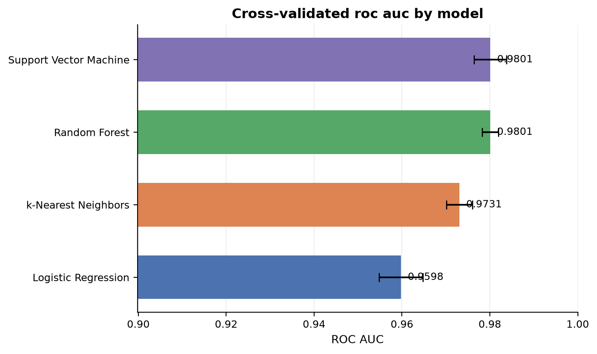
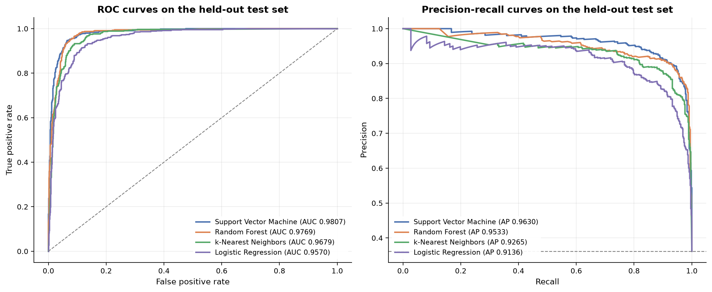
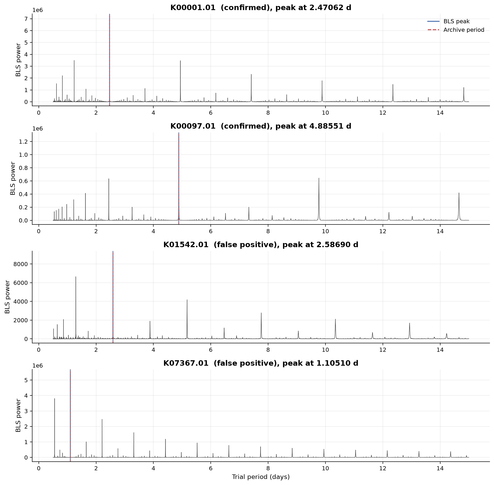
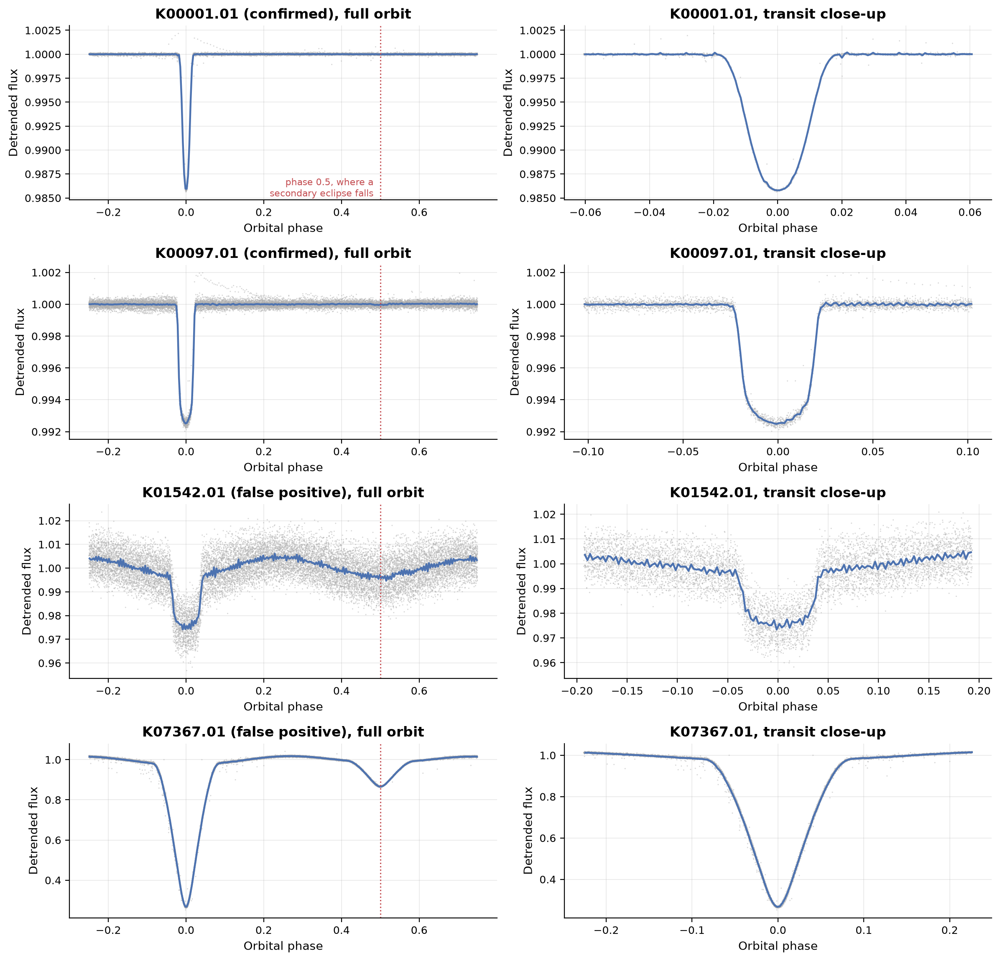

# Detecting Exoplanets in Kepler Transit Data

A machine learning classifier that tells real exoplanets apart from false positives in
NASA's Kepler mission data, plus a pipeline that measures the same features directly from
raw brightness data.

When a planet passes in front of its star it blocks a little of the light, so the star
dims briefly and does it again every orbit. Kepler flagged over 9,500 of these dips as
Kepler Objects of Interest, and about half were not planets. The usual impostor is an
eclipsing binary: two stars orbiting each other. Either they barely clip each other so
only a sliver of light is blocked, or the pair sits far behind a bright star whose light
dilutes their deep eclipse into something that looks planet-sized.

This project builds a classifier for that problem from the shape of the dip and the
properties of the star, then works through the full pipeline from raw data to prediction
on four real targets.

## Results

Four classifiers, tuned by grid search with 5-fold cross-validation, evaluated on a
held-out 20 percent of 7,586 Kepler signals.

| Model | CV ROC AUC | Test ROC AUC | Test precision | Test recall |
| --- | --- | --- | --- | --- |
| Support vector machine (RBF) | 0.980 | 0.981 | 0.896 | 0.938 |
| Random forest | 0.980 | 0.977 | 0.906 | 0.913 |
| k-nearest neighbours | 0.973 | 0.968 | 0.830 | 0.933 |
| Logistic regression | 0.960 | 0.957 | 0.802 | 0.927 |

ROC AUC measures ranking: pick one real planet and one false positive at random, and it is
the chance the model scored the planet higher.

No column from NASA's review process is used anywhere. The KOI table ships those notes
alongside the measurements, and they reproduce the answer almost exactly. Training on them
gives a model that scores beautifully and has learned nothing, so they are excluded by
construction and the notebook shows exactly how badly they leak.





## From raw light curve to prediction

The second half of the project measures period, depth, and duration from raw Kepler data
instead of reading them from a table.

The tool is a Box Least Squares periodogram. Guess a period, fold the timeline into chunks
of that length and stack them, and see whether the dips line up. The right period makes
every dip land on top of every other one. It recovers the orbital period to a few parts
per million on all four targets.



Folding on that period is what makes the two classes visible to the eye. The real planets
are flat except at the dip. Both false positives show a second, shallower dip halfway
round the orbit, which is the companion star passing behind the bright one. A planet gives
off no light of its own to block, so it cannot do that.



Feeding those measurements back through the trained classifier gives the same verdict as
NASA's own numbers on all four targets, closing the loop from raw data to prediction.

## Repository layout

```
kepler-exoplanets/
├── notebooks/
│   └── kepler_exoplanet_classification.ipynb   Full analysis, executed with outputs
├── src/keplerml/
│   ├── config.py        Paths, random seed, column groups, leakage list
│   ├── data.py          Archive download, caching, labelling, leakage checks
│   ├── features.py      Log transforms and the physics-motivated features
│   ├── modeling.py      Pipelines, grids, grouped CV, evaluation, thresholds
│   ├── lightcurves.py   Light curve retrieval, detrending, BLS, vetting statistics
│   └── viz.py           Plotting with one consistent style
├── figures/             Figures written by the notebook
├── data/                Downloaded data, populated on first run
├── requirements.txt
└── LICENSE
```

The notebook carries the analysis and the reasoning. The package carries the machinery
that would otherwise bury it: download and caching, pipeline construction, search grids,
and plotting.

## Getting started

```bash
git clone https://github.com/devenshah2018/kepler-exoplanets.git
```

```bash
cd kepler-exoplanets && python3 -m venv venv && source venv/bin/activate && pip install -r requirements.txt
```

```bash
jupyter lab notebooks/kepler_exoplanet_classification.ipynb
```

Run all cells. The first run downloads about 1 MB from the NASA Exoplanet Archive and
about 20 MB of photometry from MAST, then caches both under `data/`. Subsequent runs are
offline. End to end it takes roughly four minutes on a laptop, most of it in the random
forest grid search.

## Method

**Data.** The cumulative KOI table from the NASA Exoplanet Archive, queried over TAP for
an explicit column list so an upstream schema change fails loudly. Long cadence
photometry for the demonstration targets comes from MAST through `lightkurve`.

**Labels.** Two classes, CONFIRMED against FALSE POSITIVE, giving 2,747 planets and 4,839
false positives. The 1,978 CANDIDATE rows are dropped, since nobody knows the right answer
for them yet and including them would mean training on guesses.

**Splitting.** One star can produce up to seven signals, and stars with several signals
are far more likely to be real planetary systems. Every split therefore keeps all signals
from a star together, using `StratifiedGroupKFold` on `kepid`, so the model cannot
recognise a star instead of judging the dip.

**Features.** Twenty-seven columns describing the dip, the implied planet, and the host
star, plus four engineered ratios. Each ratio is a check an astronomer would do by hand:

| Feature | What it tests |
| --- | --- |
| Duty cycle | A planet dims its star for a tiny slice of each orbit. Two stars clipping each other take much longer. |
| Duration ratio | Whether the dip lasted as long as the fitted orbit says it should have. |
| Density ratio | The shape of a transit reveals the star's density. Whether that matches what is known about the star. |
| Signal-to-noise per transit | Many faint dips that only convince in combination, against a few that are overwhelming alone. |

The table also carries three columns describing where on the detector the dip originated,
which catches a neighbouring star bleeding into the measurement. Those are excluded, since
this project is about what the shape of the dip can tell you.

**Modelling.** Each estimator sits in a pipeline that imputes missing values and rescales
features, so both steps are refitted inside every fold and no fold is prepared using data
it will be tested on. Hyperparameters come from a grid search on ROC AUC. The decision
threshold is chosen separately, from training data only.

**Interpretation.** Permutation importance on the test set. The notebook is explicit that
many features are close relatives, which makes any one-at-a-time importance ranking
understate all of them.

## Data sources

- NASA Exoplanet Archive, cumulative KOI table, operated by Caltech under contract with
  NASA under the Exoplanet Exploration Program.
- Mikulski Archive for Space Telescopes, Kepler long cadence light curves.
- Kovacs, Zucker and Mazeh (2002), *A box-fitting algorithm in the search for periodic
  transits*, Astronomy and Astrophysics 391, 369.
- Thompson et al. (2018), *Planetary Candidates Observed by Kepler. VIII*, Astrophysical
  Journal Supplement Series 235, 38.
- Lightkurve Collaboration (2018), *Lightkurve: Kepler and TESS time series analysis in
  Python*.

## License

MIT. See [LICENSE](LICENSE).
